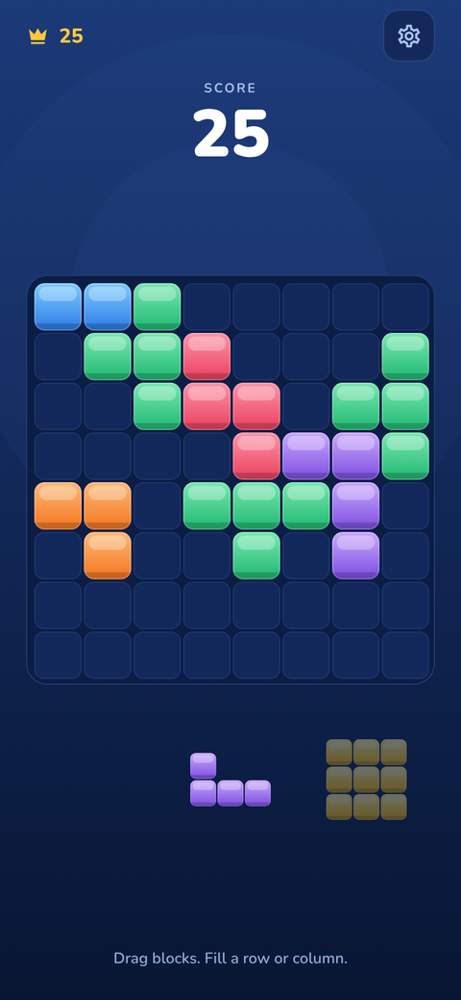
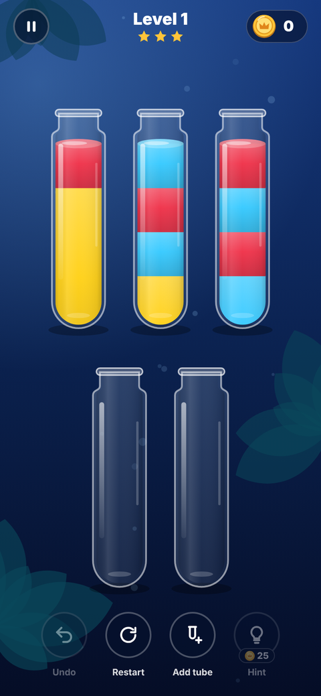
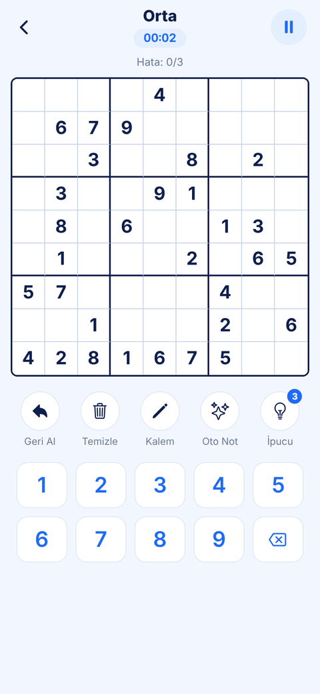
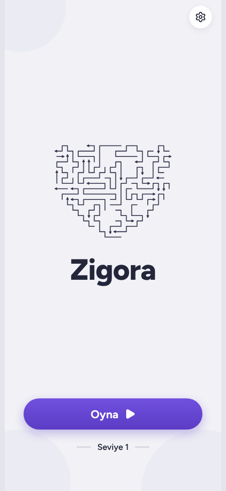
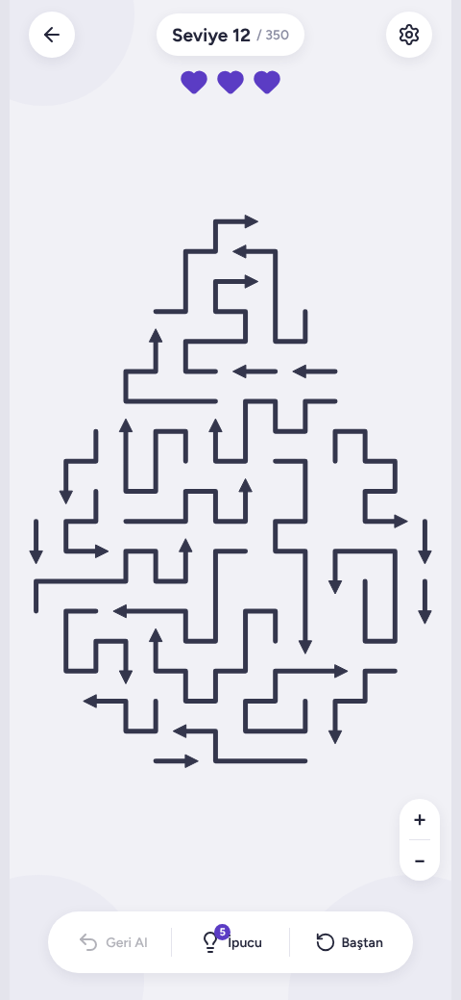

I build mobile games with Expo, React Native and TypeScript, from the visual design to the finished app.

**I'm looking for an internship in mobile development.**

## Projects

<table>
  <tr>
    <td width="25%" valign="top">
      
      <h3><a href="https://github.com/helenyildirim/block-puzzle">Block Puzzle</a></h3>
      An 8x8 block puzzle with a daily challenge, combo scoring, sound and saved games.
        
      <code>TypeScript</code> <code>Expo Router</code>
    </td>
    <td width="25%" valign="top">
      
      <h3><a href="https://github.com/helenyildirim/water-sort">Water Sort</a></h3>
      A pouring puzzle with 300 solver-checked levels, liquid animation and code-drawn art.
        
      <code>TypeScript</code> <code>SVG</code>
    </td>
    <td width="25%" valign="top">
      
      <h3><a href="https://github.com/helenyildirim/sudoku">Sudoku</a></h3>
      Sudoku with difficulty based on solving techniques, explained hints and interactive lessons.
        
      <code>TypeScript</code> <code>Expo</code>
    </td>
    <td width="25%" valign="top">
      
      
      <h3><a href="https://github.com/helenyildirim/zigora">Zigora</a></h3>
      An arrow puzzle with 350 shaped levels, each checked for a solution by a verifier script.
        
      <code>TypeScript</code> <code>Expo Router</code>
    </td>
  </tr>
</table>

## Tools

